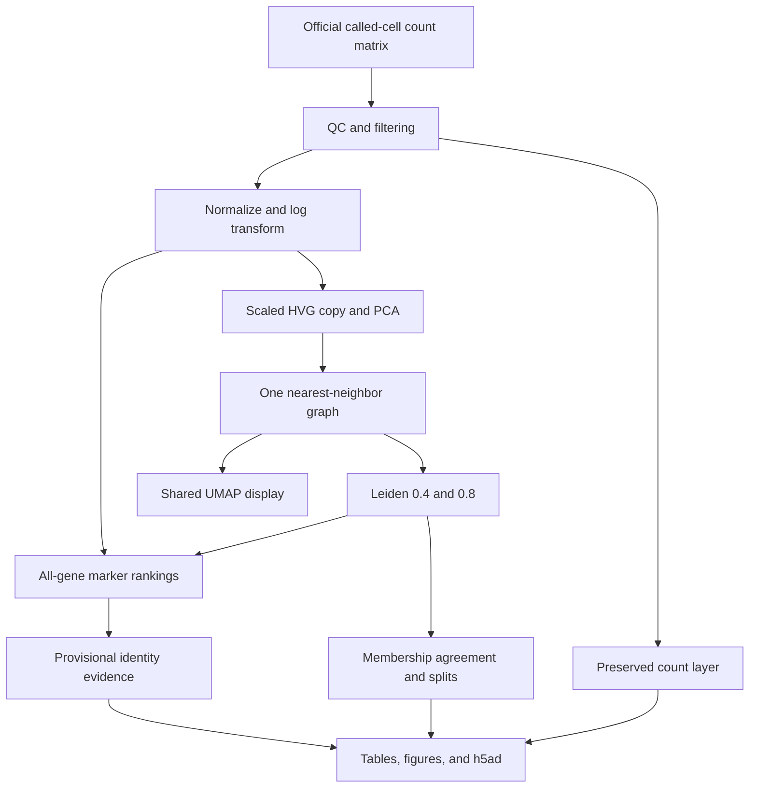

# Interview guide — Single-Cell Immune Profiling with Scanpy

## Be precise about completion

At delivery, the pipeline is implemented and locally checked, but **real PBMC execution is pending in Colab**. Say “I implemented” rather than “I found.” After completing the notebook, use your generated `OBSERVATIONS.md` and `one_cell_trace.json` for measured numbers. Do not repeat another tutorial's results as your own. This work demonstrates analysis of public sequencing data, not collecting blood, sequencing, flow cytometry, or other wet-lab experience.

## Architecture and data flow

One standalone notebook orchestrates the stages; `analysis.py` contains the same code. There is no web service, database, model API, or cloud backend.

Data flow in plain English: load molecule counts → remove questionable profiles using declared rules → preserve the surviving original counts → put expression on a comparable scale → summarize variable genes → connect similar cells → form communities → inspect gene evidence → measure sensitivity → save auditable results.

## Main structures, functions, and dependencies

| Structure / function | What it does |
|---|---|
| Sparse SciPy CSR matrix | Stores mostly nonzero values and row pointers, saving space for a matrix with many zeros |
| `AnnData` | Keeps cells, genes, matrix values, embeddings, graph, and metadata aligned |
| `.obs` / `.var` | pandas tables for cells / genes, indexed by barcodes / symbols |
| `.X` / `.layers['counts']` | Log-normalized expression / preserved integer-valued counts |
| `.obsm`, `.varm` | Per-cell coordinates and per-gene PCA loadings |
| `.obsp`, `.uns` | Pairwise graph matrices and settings / ranking results |
| `CFG`, `PANELS` | Dictionaries of declared settings and marker panels |
| `sc.datasets.pbmc3k` | Official raw count download; not the processed-data loader |
| `calculate_qc_metrics`, `qc_decisions` | Measure per-cell quality and return overlapping fail flags plus a pass mask |
| `normalize_total`, `log1p` | Depth normalization and dynamic-range compression |
| `highly_variable_genes`, `scale`, `pca` | Select informative variability, balance gene scales, compress features |
| `neighbors`, `leiden`, `umap` | Build graph, detect communities, visualize graph structure |
| `rank_genes_groups` | Exploratory cluster-versus-rest gene ranking on unscaled log-expression |
| `propose_identity` | Two-or-more-marker rules with explicit competing-lineage uncertainty |
| `partition_comparison` | Label-invariant ARI, cross-tabulation, retention, purity, and split summaries |
| `sparse_fingerprint` | SHA-256 of matrix shape, values, and structure to detect unwanted mutation |
| `write_h5ad`, `read_h5ad` | Save/reload the annotated experiment; verify counts and labels round-trip |
| NumPy / pandas / SciPy | Numerical arrays, tables, sparse data |
| Scanpy / AnnData | Single-cell algorithms and aligned storage |
| scikit-learn | ARI and components used by numerical workflows |
| igraph / leidenalg | Graph representation and Leiden optimization |
| umap-learn / pynndescent / Numba | Embedding, neighbor infrastructure, compiled numerical work |
| Matplotlib / seaborn | Figures; Scanpy plotting uses these libraries |
| h5py / zarr | Storage dependencies; this project exports HDF5-backed `.h5ad` |

No custom classes or SQL tables were added. The primary object is AnnData, a third-party class. The functions listed above perform the custom audit, reporting, and heuristic-annotation logic.

## One cell moving through the analysis

Use the barcode and values from `one_cell_trace.json` after execution. Before execution, the following is **illustrative arithmetic, not a measured PBMC cell**:

A cell has 2,000 UMI counts across retained genes, and a particular gene has 4 counts. Library-size normalization gives `4 / 2000 × 10000 = 20`. Log transformation gives `ln(21) ≈ 3.045`. The counts layer still stores 4. QC used the cell's original detected-gene count and mitochondrial fraction before gene filtering; a failed cell would stop there and never receive a cluster.

If the gene is selected as highly variable, its value contributes to a standardized feature vector and PCA. The cell's 40 PCA coordinates are used to find neighbors. Leiden assigns the cell a group at each resolution. UMAP provides a display position. Group-level marker evidence proposes an identity, and the cell inherits that provisional group label; the pipeline has not independently verified that individual cell's identity. The export stores both cluster memberships so we can see whether the cell moved when resolution changed.

## Why the main methods exist

**Normalization:** two cells can have different total captured RNA because of sequencing depth or biology. Comparing raw counts alone can confuse depth with expression differences. Scaling totals to 10,000 addresses one source of difference, but assumes total-count adjustment is reasonable and does not eliminate all confounding.

**PCA:** thousands of correlated genes can be summarized into fewer directions of coordinated variation. This reduces computation and noise in neighbor search. PCA components are combinations of genes, not named biological cell types. A component may also reflect unwanted technical variation.

**Clustering:** the dataset has no supervised ground-truth labels supplied to this pipeline. Leiden groups densely connected regions of the similarity graph. It generates hypotheses about populations rather than confirming them.

**UMAP:** a plot of two coordinates is easier to inspect than 40 PCA coordinates. UMAP is useful for local patterns and QC, but loses information. Clustering runs on the graph, not on hand-drawn regions of the UMAP plot.

## Design choices and tradeoffs

These are **explicit project decisions**, rather than invented accounts of what the Scanpy authors intended.

| Choice | Reason here | Alternative / tradeoff |
|---|---|---|
| Small official PBMC3k dataset | Finish a comprehensible workflow with modest CPU resources | Larger multi-donor data improves scope but needs more compute and careful replication |
| Preserve counts separately | Protect raw values and allow appropriate count-based downstream work | Extra storage; a `.raw` snapshot alone does not guarantee original counts |
| Reference-style fixed QC | Transparent, easy to audit, and appropriate as an educational starting point | Data-adaptive robust cutoffs may be better; fixed cutoffs may remove real biology |
| No nuisance regression | Avoid removing expression associated with genuine cell differences without a strong rationale | Technical depth/mitochondrial effects may remain; regression has its own assumptions |
| Separate scaled HVG workspace | Keep marker expression unscaled and retain all genes | Uses an additional, small dense matrix |
| 2,000 HVGs and 40 PCs | Fixed pragmatic scope for this experiment | Pearson residuals or other feature choices can change neighborhoods; not evaluated here |
| Leiden on one graph | Isolate resolution as the changed parameter | Does not assess uncertainty from graph construction or random seeds |
| Wilcoxon marker rankings | Accessible nonparametric exploration with detection-fraction evidence | Not confirmatory inference; replicated pseudobulk would be needed for condition comparisons |
| Rule-based broad proposals | Explainable, no pretrained reference or external API needed | Conservative, uncalibrated rules can misclassify or leave groups unassigned |
| ARI plus overlap table | Global comparison plus interpretable group-level changes | ARI is dominated by pair counts and can hide rare-group changes |
| Pinned main versions and environment export | Make execution settings inspectable and easier to reproduce | Transitive packages/hardware can still differ; full Colab integration remains to be checked |

**Inferred design reason — labeled as inference:** a plausible reason that introductory workflows use modest numbers of PCs and neighbors is to balance computational cost and useful signal. This is an inference, not a documented explanation of every reference author's parameter selection. The project's own parameter decisions above are explicit.

## A 30-second explanation

“I implemented a Scanpy workflow for public single-cell RNA counts from blood immune cells. It performs quality control, preserves original counts, normalizes expression, and builds a PCA-based neighbor graph for Leiden clustering. It proposes broad identities from multiple markers and explicitly flags uncertainty. My added experiment compares two resolutions on the same graph using adjusted Rand index and group-level overlap. The code and helper checks are complete; the real dataset run is pending in Colab.”

After a successful run, replace only the last sentence with your measured retained-cell count and ARI from the generated report. Do not claim independent biological validation.

## A deeper explanation

“The input is a sparse cells-by-genes UMI matrix, already aligned and quantified by Cell Ranger. I use AnnData to keep expression values aligned with cell barcodes and gene metadata. QC examines total molecules, detected genes, and mitochondrial fraction. Filtering is explicit and audited with a waterfall. I retain original counts in a layer, normalize and log-transform a separate expression representation, then choose variable genes for dimensionality reduction.

“I scale only the PCA workspace, because centered expression is not the representation I want for marker interpretation. A fixed neighbor graph is built from 40 PCs. Leiden creates communities at resolutions 0.4 and 0.8; UMAP is only a shared visualization. Marker rankings use all retained genes on the unscaled log-expression matrix, and broad labels require multiple supporting markers. Competing evidence remains uncertain.

“The sensitivity comparison uses label-invariant ARI plus cell-membership tables. I check both retention and child purity to avoid calling a merged group stable. The output records settings, environment, preserved-count hashes, and an example cell's transformation. This is one donor with no independent validation, so the analysis cannot establish disease effects or clinical conclusions.”

## Eight likely interview questions

1. **What exactly is being counted?**
   UMI-based captured RNA molecules assigned to genes and called cell barcodes. The data are not direct protein measurements, all RNA molecules in a cell, or raw sequencing reads. A low count or zero can be influenced by sampling.

2. **Why not cluster the raw counts?**
   Library-size differences can dominate distances. Normalization reduces that effect, log transformation limits extreme dynamic range, and PCA reduces noise and dimension. These transformations have assumptions; they are not guaranteed to remove all technical variation.

3. **Why keep raw counts if you normalize them?**
   QC and count-based statistical models require original counts. I preserve them independently so preprocessing cannot overwrite them. Here `.X` holds log expression, `.layers['counts']` holds counts, and the original unfiltered matrix is a separate export.

4. **How do you know a group is a T cell or an NK cell?**
   I do not know with certainty. I combine marker evidence such as CD3 genes for T-like cells and NKG7/GNLY for cytotoxic programs, including counterevidence because those programs overlap. Conflicts receive uncertain labels. Reference mapping or protein measurements would provide additional evidence.

5. **What does ARI tell you, and what does it miss?**
   It compares pairwise co-membership between two partitions independent of arbitrary cluster IDs and adjusts for chance. It measures agreement, not correctness. A global score can obscure rare populations, so I also inspect cross-tabs, retention, child purity, and the markers of groups that split.

6. **Why is a small marker p-value not proof of a biological discovery?**
   Clusters were discovered in the same data used for testing, and cells from one donor are not independent biological replicates. The rankings are exploratory summaries. Disease or treatment comparisons would require appropriate replicated samples and a sample-aware design, often pseudobulk analysis.

7. **Can you use the UMAP distances to infer a developmental pathway?**
   No. A 2D embedding distorts information, especially global relationships. Nearby display points alone do not establish cell identity, lineage, timing, or causality. Trajectory claims need an appropriate design and independent evidence.

8. **How did you validate the pipeline and what remains?**
   At delivery, I compiled all code cells, checked notebook structure, and smoke-tested QC boundaries, sparse-count integrity, annotation ambiguity, and label-invariant partition metrics on synthetic inputs. Full PBMC execution remains in Colab. The notebook includes real-run assertions for counts, a fixed graph, normalization, and `.h5ad` round-trip. After running, I would report those checks and observed results, then add donor replication, broader sensitivity tests, and independent annotation validation.
